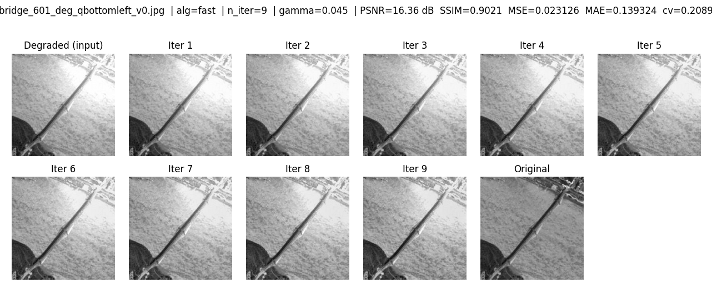
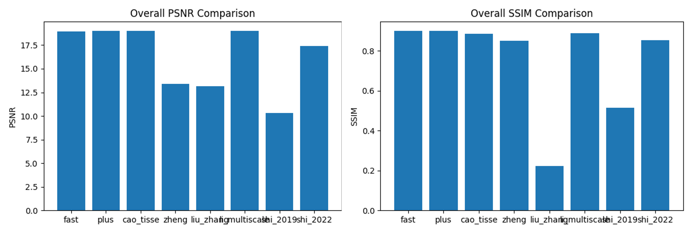
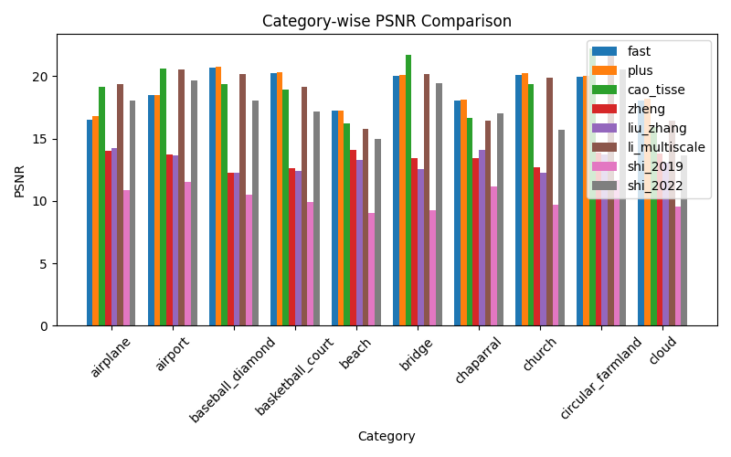
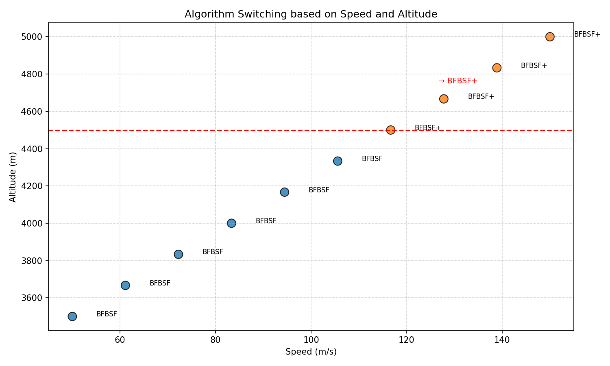
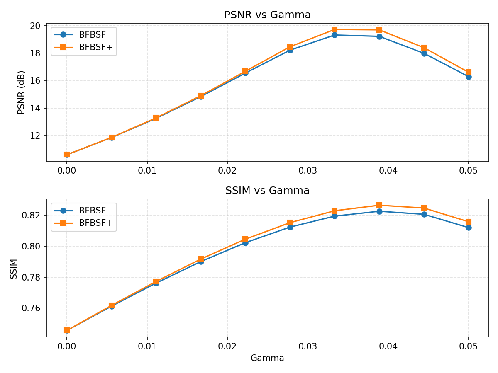
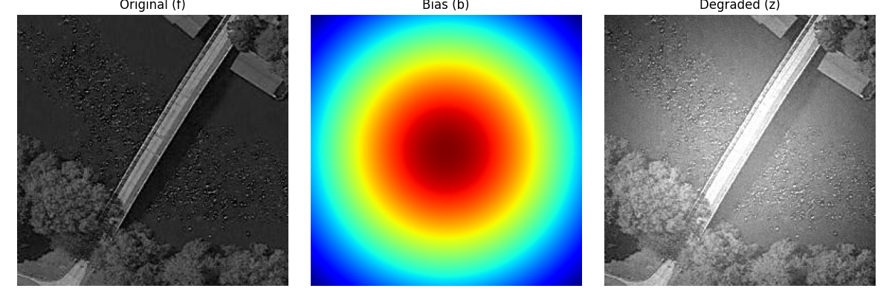
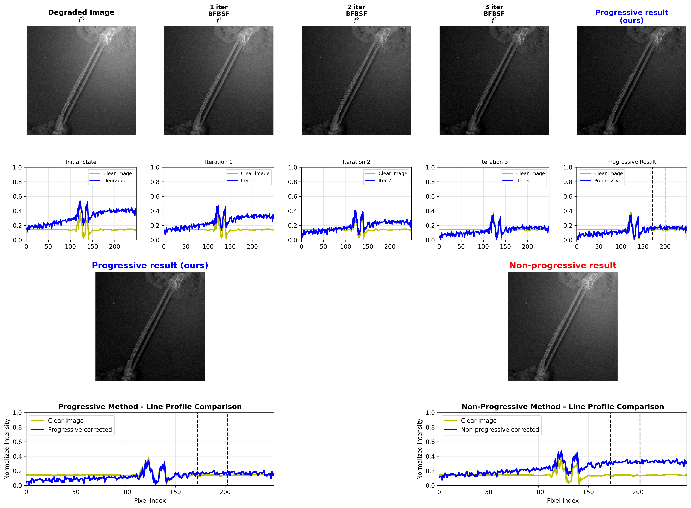

# Thermal Image Cleanup with Bilateral Filtering and Bézier Surfaces

Infrared cameras on fast aircraft get a **bright, uneven "glow"** in their images because airflow heats the
camera window. This project removes that glow (nonuniformity correction) with a **progressive bilateral-filter +
Bézier-surface** method, and adds an **adaptive controller** that switches between a FAST and a PLUS mode
depending on the aircraft's altitude and speed.




## Results

| Scene | PSNR (dB) | SSIM |
|---|---:|---:|
| Bridge | 16.36 | 0.902 |
| Island | 20.69 | 0.913 |
| Residential | 21.19 | 0.904 |

- **Average PSNR ≈ 19.0 dB and SSIM ≈ 0.90** across test scenes, with a stable coefficient of variation (CV ≈ 0.35).
- **Beat existing correction methods** on PSNR and SSIM: Cao & Tisse, Zheng et al., Liu & Zhang, Li (multiscale) and Shi et al.
- **Adaptive switching works:** the controller moves from FAST to PLUS mode at about 4,500 m altitude or 120 m/s,
  and stays within ±0.5 dB of the best PSNR.
- **Best regularisation:** γ ≈ 0.03–0.045. PLUS mode is slightly more accurate, and FAST mode is quicker with little loss.

| Overall comparison | Category-wise PSNR |
|---|---|
|  |  |

| FAST/PLUS switching | Effect of γ |
|---|---|
|  |  |

## How it works

1. **Simulate the glow:** add a smooth, bright bias field to a clean image to create a test image with a known answer.
2. **Estimate the bias:** a bilateral filter picks out the low-frequency glow while keeping edges.
3. **Smooth it:** fit a Bézier surface to the estimate. The surface degree drops each iteration to avoid overfitting.
4. **Subtract and repeat:** remove the bias and repeat for N iterations (progressive correction).
   A gradient-orientation (HOG) prior keeps both the bias and the recovered image realistic.
5. **Choose the mode:**
   - **FAST (BFBSF):** searches the filter parameters once, for low altitude or speed
   - **PLUS (BFBSF⁺):** re-searches them every iteration, for high altitude or speed

| Synthetic degradation | Progressive vs non-progressive |
|---|---|
|  |  |

Algorithm pseudocode: [BFBSF⁺](figures/algorithm_bfbsf_plus.png) · [BFBSF](figures/algorithm_bfbsf.png)

## Code

| File | What it does |
|---|---|
| [`src/Algo2.py`](src/Algo2.py) | Main implementation: `bfbsf()` (FAST) and `bfbsf_plus()` (PLUS), with bilateral filtering, Bézier fitting and the HOG prior |
| [`src/bfbsfnet.py`](src/bfbsfnet.py) | Prototype "unrolled" single-pass version (BFBSFNet style) |
| [`src/pabg.py`](src/pabg.py) | Prototype physics-aware bias recovery (PABR) with a heat-equation penalty |
| [`experiments/`](experiments/) | Earlier versions, GPU (CuPy/PyTorch) ports and the degradation script |

## How to run

```bash
git clone https://github.com/srikarasudan/thermal-image-nonuniformity-correction.git
cd thermal-image-nonuniformity-correction
pip install -r requirements.txt
cd src
python Algo2.py      # corrects output_degraded.png with FAST and PLUS modes and shows the results
```

The GPU experiments in `experiments/` also need PyTorch (`experiments/requirements-torch.txt`) and CuPy.

A small web demo was also built to upload an image, degrade it, correct it and show the metrics:
[screenshot](figures/demo_gui.png).

## My role

Team mini project. **I ran the experiments and evaluation (PSNR, SSIM and CV across scenes and categories),
produced the figures and wrote the report.** Sivakavin K E wrote the core BFBSF / BFBSF⁺ implementation (`Algo2.py`).

## About

Mini project (CSE398 – Project Phase I), B.Tech. Computer Science & Business Systems, SASTRA Deemed University
(Aug 2025 – Jan 2026).

**Based on:** Hong, H., Liu, J., Shi, Y., Xiong, L., Sang, N., & Zhang, T. (2023). *Progressive Nonuniformity
Correction for Aero-Optical Thermal Radiation Images via Bilateral Filtering and Bézier Surface Fitting.*
IEEE Photonics Journal, 15(2), 7800611.

**Author:** Srikarasudan P R · [LinkedIn](https://www.linkedin.com/in/srikarasudan-p-r-4b4423212/)
